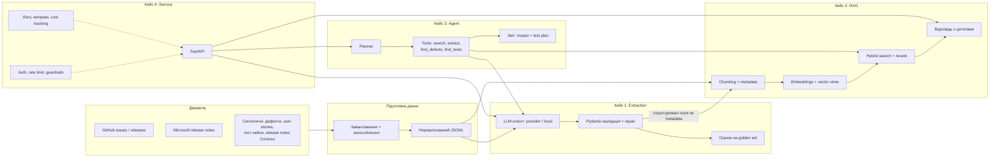
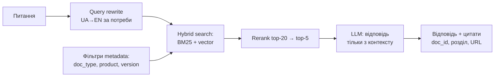
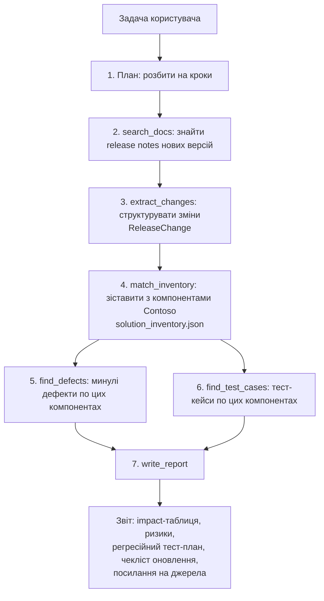

# AI Release Intelligence Assistant — специфікація проєкту

> Наскрізний курсовий проєкт курсу AI Engineering (2 потік).
> Автор: Power Platform Development Lead. Версія специфікації: 0.2, 18.10.2026.
> **Усі дані в репозиторії публічні або синтетичні.** Жодних внутрішніх даних компанії.

---

## 0. Узгодження з ТЗ курсу

Розподіл вимог по кейсах у цій специфікації взято з **офіційного ТЗ курсу**, а не з чернетки запиту:

| Кейс | Що вимагає курс | Дедлайн |
|---|---|---|
| 1 | Extraction за Pydantic-схемою + structured output, провайдерська vs локальна модель, **golden set (10), field accuracy, % валідних, latency p50/p95, вартість на 1000 документів**, версії промптів | чекпоінт 24.10, здача **27.10** |
| 2 | RAG: семантичний пошук, відповіді з посиланнями на джерела, тести якості | за розкладом |
| 3 | Агент: багатокрокові задачі через інструменти | за розкладом |
| 4 | Сервіс: API, безпека, моніторинг, логування, облік вартості | Demo Day |

Важливо: метрики (golden set, accuracy, latency, cost) — це **вже кейс 1**, а не 2.

---

## 1. Бізнес-проблема

Команди, що розробляють і супроводжують рішення на Microsoft Power Platform, живуть у потоці змін:

- **зовнішні зміни** — Microsoft щомісяця оновлює Power Platform, Dataverse, Power Automate, pac CLI, CoE Starter Kit; щось депрекейтиться, щось ламає зворотну сумісність;
- **внутрішні зміни** — власні релізи рішення, баг-репорти, user stories, тест-кейси, інструкції з встановлення.

Ця інформація розкидана по release notes, GitHub, Azure DevOps, листах і Teams, написана різними мовами й у різному стилі. Щоб відповісти на питання *«що зачепить наступне оновлення і що треба перетестувати?»*, Release/QA lead вручну читає десятки документів. Це повільно, і щось завжди пропускається — звідси регресії на проді.

## 2. Цільові користувачі

| Роль | Що потрібно |
|---|---|
| Release Manager / Dev Lead | які зміни входять у реліз, ризики, breaking changes, чекліст оновлення |
| QA Lead / тестувальник | які тест-кейси запускати регресійно, які старі дефекти можуть повернутися |
| Power Platform розробник | чи зачіпає нова версія pac CLI / платформи наші flows, плагіни, PCF |
| PM / Product Owner | короткий статус: що змінилось і чи безпечно оновлюватися |

## 3. Бізнес-цінність

- **Час:** аналіз релізу — з кількох годин ручного читання до хвилин.
- **Якість:** менше пропущених breaking changes і регресій на проді.
- **Прозорість:** кожна відповідь має посилання на джерело — рішення можна перевірити.
- **Структура:** сирі баг-репорти й нотатки стають стандартизованими записами, придатними для звітів і пошуку.
- **Інтеграція:** API можна викликати з Power Automate через custom connector — AI вбудовується в звичний процес команди.

---

## 4. Архітектура рішення



**Ключова ідея:** кожен кейс — шар над попереднім. Extraction з кейсу 1 дає структуровані поля (компонент, версія, середовище), які в кейсі 2 стають метаданими для фільтрації пошуку, а в кейсі 3 — входом для агента.

**Єдиний LLM-інтерфейс** (`src/llm/`) з самого початку: `generate_structured(text, schema, prompt, params) -> (result, usage, latency)`. Його реалізують `OpenRouterClient` і `OllamaClient`. Усі наступні кейси працюють тільки через цей інтерфейс — модель можна замінити конфігом.

---

## 5. Структура репозиторію

```
release-intelligence/
├── README.md                # що це, як запустити однією командою
├── REPORT.md                # звіт-порівняння моделей (кейс 1)
├── Makefile                 # make run / make eval / make test
├── main.py                  # точка входу: python main.py
├── pyproject.toml
├── .env.example             # OPENROUTER_API_KEY=, GITHUB_TOKEN=
├── .gitignore
├── config/
│   └── models.yaml          # моделі, temperature/top_p, ціни за токен
├── docs/
│   └── SPEC.md              # ця специфікація
├── data/
│   ├── synthetic/           # Contoso: дефекти, release notes, user stories, тест-кейси, інвентар рішення
│   ├── github/              # знеособлені issues і releases
│   ├── public/              # Microsoft release notes, changelogs
│   └── golden/
│       ├── golden_set.json  # еталонна розмітка (JSON з відступами — редагується вручну)
│       └── ANNOTATION_GUIDE.md
├── prompts/
│   └── extract_defect/
│       ├── v1.md
│       ├── v2.md
│       └── CHANGELOG.md
├── src/
│   ├── schema.py            # Pydantic-схеми
│   ├── llm/                 # base.py, openrouter.py, ollama.py
│   ├── extraction/          # пайплайн: промпт → модель → валідація → repair → лог
│   ├── evaluation/          # field accuracy, latency, cost
│   ├── rag/                 # кейс 2
│   ├── agent/               # кейс 3
│   └── api/                 # кейс 4
├── scripts/                 # завантаження даних, конвертери
├── results/                 # виходи моделей + метрики (JSONL/CSV)
├── eval/                    # питання для RAG і задачі для агента
└── tests/                   # pytest
```

**Принцип по кейсах:** після кожного кейсу — git-тег (`case-1`, `case-2`…), щоб викладач бачив стабільну версію.

---

## 6. Структура даних

### 6.1. Єдиний формат сирого документа (JSONL, один документ на рядок)

```json
{
  "id": "syn-001",
  "doc_type": "defect",
  "source": "synthetic",
  "channel": "devops",
  "product": "Contoso Procurement",
  "version": null,
  "lang": "uk",
  "origin": null,
  "text": "Title: Не зберігається заявка..."
}
```

| Поле | Значення |
|---|---|
| `doc_type` | `defect` · `release_note` · `user_story` · `test_case` · `install_guide` · `changelog` |
| `source` | `synthetic` · `github` · `microsoft` |
| `channel` | `devops` · `teams` · `email` · `test_run` · `github_issue` · `github_release` · `docs` |
| `lang` | `uk` · `en` · `mixed` · `other` |
| `origin` | для публічних — `repo#номер` або URL сторінки; для синтетичних — `null` |

> TODO: поточні файли `data/synthetic/defects_synthetic.jsonl` і `data/github/defects_github.jsonl` ще не мають полів `doc_type`, `product`, `version`, `lang` — додати скриптом.

### 6.2. Вигаданий світ для синтетичних даних

Компанія **Contoso**, рішення «Procurement & Projects» на Power Platform:
таблиці `cnt_request`, `cnt_approval`, `cnt_invoice`, `cnt_project`, `cnt_projecttask`, `cnt_risk`;
canvas app «Заявки на закупівлю», model-driven app «Project Hub»; flows «Approval Flow v2», «LEO Task Sync»;
середовища DEV/TEST/UAT/PROD; релізи 1.4.2 – 1.5.3. Деталі — `data/synthetic/GENERATION.md`.

Файл `data/synthetic/solution_inventory.json` (кейс 3) — перелік компонентів рішення Contoso і їхніх залежностей (від яких конекторів, версій pac CLI, функцій платформи залежать). Це дозволяє агенту зіставити зовнішню зміну з внутрішніми компонентами.

---

## 7. Pydantic-схема для кейсу 1

**Одиниця extraction — баг-репорт** (`DefectReport`). Чому саме він, а не release notes:

1. ТЗ вимагає **«брудні»** тексти: різна довжина, помилки, пропуски, змішані мови. Баг-репорти такі за природою; публічні release notes — відносно охайні.
2. Плоска схема з одним вкладеним списком — **field accuracy рахується чесно і просто**. Схема release notes зі списком змін потребує зіставлення списків, що ускладнює кейс 1 у межах 9 годин.
3. Дані вже зібрані: 20 синтетичних + 20 GitHub = 40 текстів.

Release notes підключаються в кейсі 2 (RAG) і кейсі 3 (агент). Друга схема `ReleaseChange` (див. 7.2) — stretch-ціль.

### 7.1. `DefectReport` (реалізовано: `src/schema.py`)

| Поле | Тип | Вимога ТЗ |
|---|---|---|
| `title` | `str` | |
| `is_defect` | `bool` | |
| `components` | `list[Component]` | **вкладений об'єкт + список** |
| `environments` | `list[Environment]` | **enum** |
| `severity` | `Severity \| None` | **enum** |
| `release_version` | `str \| None` | |
| `steps_to_reproduce` | `list[str]` | список |
| `expected_result` | `str \| None` | |
| `actual_result` | `str \| None` | |
| `is_regression` | `bool \| None` | |

`Component = {type: ComponentType, name: str | None}`,
`ComponentType` = table · cloud_flow · canvas_app · model_driven_app · plugin · pcf · business_rule · security_role · solution · alm_tooling · leo_ppm · other.

Правила: немає даних → `null` / `[]`, не вгадувати; `extra="forbid"`; усі поля required-nullable (сумісно зі strict structured output).

### 7.2. `ReleaseChange` (stretch, кейс 2–3)

```python
class ChangeType(str, Enum):
    FEATURE = "feature"; FIX = "fix"; IMPROVEMENT = "improvement"
    DEPRECATION = "deprecation"; BREAKING = "breaking"; SECURITY = "security"

class ReleaseChange(BaseModel):
    product: str                    # "pac CLI", "CoE Starter Kit", "Contoso Procurement"
    version: str | None
    release_date: date | None
    change_type: ChangeType
    summary: str
    affected_components: list[Component]
    action_required: bool           # чи треба щось робити при оновленні
    action_description: str | None
```

---

## 8. Документи (30–50 для кейсу 1 + корпус для RAG)

### 8.1. Кейс 1 — extraction (40 текстів, вже є)

| Набір | К-сть | Що це | Чому підходить |
|---|---|---|---|
| `data/synthetic/defects_synthetic.jsonl` | 20 | баг-репорти Contoso: DevOps, Teams, email, тест-рани | українська/англійська/суржик, пропуски, емодзі, не-дефекти |
| `data/github/defects_github.jsonl` | 20 | issues з міткою `bug`: `microsoft/coe-starter-kit`, `microsoft/powerplatform-build-tools` | реальні тексти: стектрейси, шаблони, італійська мова в логах |

Опційно +10 синтетичних, згенерованих **іншою моделлю** (промпт у `GENERATION.md`) — щоб зменшити зміщення.

### 8.2. Кейс 2 — корпус для RAG (~80–120 документів)

| Джерело | Приблизно | Де взяти |
|---|---|---|
| GitHub Releases `microsoft/powerplatform-build-tools` (pac CLI) | 20–30 | GitHub API `/releases` |
| GitHub Releases `microsoft/coe-starter-kit` | 15–20 | GitHub API `/releases` |
| Power Platform release plans / «What's new» (Power Apps, Power Automate, Dataverse) | 10–15 сторінок | learn.microsoft.com (перевірити ліцензію; більшість документації MicrosoftDocs — CC BY 4.0) |
| Azure DevOps release notes | 5–10 | learn.microsoft.com/azure/devops/release-notes |
| Синтетичні release notes Contoso 1.4.2–1.5.3 | 6–8 | генеруємо |
| Синтетичні user stories | 15–20 | генеруємо |
| Синтетичні тест-кейси | 20–30 | генеруємо, з посиланням на компоненти |
| Синтетична installation guide | 2–3 | генеруємо |
| Дефекти з кейсу 1 | 40 | вже є |

---

## 9. Golden set

**Розмір:** 10 текстів (мінімум ТЗ), у кейсі 2 розширити до 20.

**Відбір (стратифікований):**

| Що | К-сть | Приклади |
|---|---|---|
| Синтетичні «чисті» (шаблон DevOps) | 2 | syn-001, syn-010 |
| Синтетичні «брудні» | 3 | syn-005, syn-009, syn-017 |
| Складні / пастки | 2 | syn-018 (known issue), syn-020 (побажання) |
| GitHub | 3 | з різних репо, один з іноземною мовою в логах (gh-011) |

**Процес:**
1. Написати `data/golden/ANNOTATION_GUIDE.md` — правила для кожного поля (що вважати `severity: high`, коли `is_regression = null`, як писати `name` компонента).
2. Модель робить **чернетку** розмітки (pre-labeling).
3. Автор **вручну перевіряє кожне поле** за гайдом і виправляє. Відповідальність за еталон — людська.
4. Через день — повторна перевірка «свіжим оком» 3 випадкових записів.
5. Формат: `{"id": "syn-001", "expected": {…DefectReport…}, "notes": "…"}`.
6. Golden set **не використовувати для підбору прикладів у промпт** (few-shot) — інакше метрики завищені.

---

## 10. Моделі

| Роль | Модель | Як | Чому |
|---|---|---|---|
| Provider (основна) | `openai/gpt-4o-mini` | OpenRouter, structured output (`response_format: json_schema`, strict) | дешева, підтримує strict schema, приклад з курсу |
| Local | `qwen2.5:7b-instruct` (або новіша Qwen аналогічного розміру); `qwen2.5:3b` при < 16 ГБ RAM | Ollama, `format=<JSON schema>` | хороша багатомовність, працює на ноутбуці |
| Stretch: третя | Claude Haiku через OpenRouter | той самий інтерфейс | дешева провайдерська для порівняння |

**Семплінг:** мінімум 2 конфігурації на модель — `A: temperature=0, top_p=1` (детермінована) і `B: temperature=0.7, top_p=0.9`.

**Зауваження про зміщення:** синтетичні тексти написані моделлю Claude. Тому основна провайдерська модель — не Claude; якщо Claude буде третьою, це вказати в REPORT.md.

---

## 11. Метрики якості

### Кейс 1 — extraction

| Метрика | Як рахується |
|---|---|
| **Field accuracy** (по кожному полю + середнє) | enum, bool, `release_version` — точний збіг після нормалізації; `null` vs значення — теж оцінюється |
| Списки (`environments`, `components.type`) | F1 по множинах |
| `components.name`, `steps_to_reproduce` | fuzzy-збіг (rapidfuzz, поріг 0.8) |
| Текстові (`title`, `expected_result`, `actual_result`) | «заповнено коли треба» + fuzzy-схожість; опційно LLM-judge |
| **% валідних** | частка відповідей, що пройшли Pydantic з 1-ї спроби / після repair / failed |
| **Latency** | p50, p95 по всіх 40 текстах |
| **Вартість на 1000 документів** | середні input/output токени × ціна з `config/models.yaml`; для локальної — $0 API + час обробки |

Кожен запуск логується: модель, версія промпту, семплінг, токени, latency, статус.

### Кейс 2 — RAG
Hit@k і MRR (чи знайдено правильний документ), faithfulness (відповідь спирається лише на знайдене), **точність цитат** (посилання справді підтверджує твердження), correctness через LLM-judge на 20–30 питаннях з `eval/rag_questions.jsonl`.

### Кейс 3–4 — агент і сервіс
Task success rate на 10 задачах, середня к-сть кроків, вартість і час на задачу; у сервісі — p95 latency, error rate, вартість на запит/день.

---

## 12. RAG-архітектура (кейс 2)



| Компонент | Рішення | Чому |
|---|---|---|
| Chunking | по заголовках Markdown (одна зміна / розділ release notes = chunk), ~300–800 токенів, overlap 50 | release notes природно діляться на пункти |
| Metadata | `doc_type`, `product`, `version`, `date`, `source`, `origin` + поля з extraction (компоненти, середовище) | фільтр «тільки pac CLI 1.4x» |
| Embeddings | `bge-m3` локально через Ollama (багатомовна, безкоштовна) | українські питання до англійських документів |
| Vector store | Chroma (локально, файлом) | без сервера, просто для курсу |
| Пошук | hybrid: BM25 + вектор | точні рядки (`cnt_invoice`, `1.46.1`, коди помилок) вектор шукає погано |
| Відповідь | промпт «відповідай лише з наданого контексту, кожне твердження — з [id]»; «не знаю», якщо немає | без вигадок |
| Безпека | текст документів — дані, не інструкції (захист від prompt injection у GitHub-текстах) | |

---

## 13. Agent workflow (кейс 3)

**Типова задача:**
> «Microsoft випустив pac CLI 1.47 і оновлення CoE Starter Kit. Ми плануємо реліз Contoso 1.6.0. Що зачеплено і що треба перетестувати?»



| Інструмент | Що робить | Звідки |
|---|---|---|
| `search_docs(query, filters)` | пошук по корпусу | RAG, кейс 2 |
| `extract_changes(doc_id)` | структурує release notes | extraction, кейс 1 |
| `match_inventory(changes)` | які компоненти Contoso зачеплено | `solution_inventory.json` |
| `find_defects(component)` | минулі дефекти, регресії | структуровані дефекти з кейсу 1 |
| `find_test_cases(component)` | тест-кейси для регресії | синтетичні тест-кейси |
| `write_report(sections)` | збирає Markdown-звіт | — |

**Обмеження:** max 10 кроків, лише read-only інструменти, бюджет токенів на задачу, кожен крок логується; фінальний звіт — рекомендація, рішення приймає людина.

**Реалізація агента:** власний цикл tool calling поверх того самого `LLMClient` (без важких фреймворків) — так видно кожен крок, легше логувати вартість і обмежувати бюджет. Стан запуску (`run_id`, кроки, виклики інструментів, токени) пишеться в SQLite.

---

## 14. API endpoints (кейс 4)

FastAPI, версіонування через префікс `/v1`, OpenAPI-специфікація генерується автоматично.

### 14.1. Перелік

| Метод | Шлях | Призначення | Роль |
|---|---|---|---|
| `GET` | `/health` | liveness: процес живий | без ключа |
| `GET` | `/ready` | readiness: доступні OpenRouter, Ollama, vector store | без ключа |
| `POST` | `/v1/extract` | один текст → `DefectReport` | `reader` |
| `POST` | `/v1/extract/batch` | до 20 текстів за запит | `reader` |
| `POST` | `/v1/search` | «сирий» пошук: chunks зі scores (для дебагу і UI) | `reader` |
| `POST` | `/v1/ask` | питання → відповідь з цитатами | `reader` |
| `GET` | `/v1/documents/{doc_id}` | оригінал документа, на який посилається цитата | `reader` |
| `POST` | `/v1/agent/runs` | запустити агента → `202 Accepted` + `run_id` | `operator` |
| `GET` | `/v1/agent/runs/{run_id}` | статус, кроки, фінальний звіт, вартість | `operator` |
| `GET` | `/v1/usage` | вартість і токени за період, по моделях і endpoint-ах | `admin` |
| `GET` | `/metrics` | метрики у форматі Prometheus | внутрішній |

### 14.2. Контракти основних endpoint-ів

**`POST /v1/extract`**
```json
// request
{
  "text": "при імпорті солюшена на тест вилітає помилка ...",
  "model": "auto",            // auto | provider | local
  "prompt_version": null      // null = поточна production-версія
}
// response 200
{
  "status": "ok",             // ok | repaired | failed
  "result": { "...": "DefectReport" },
  "meta": {
    "request_id": "req_01J...",
    "model": "openai/gpt-4o-mini",
    "prompt_version": "extract_defect/v2",
    "latency_ms": 1840,
    "tokens_in": 812, "tokens_out": 214,
    "cost_usd": 0.00025
  }
}
```

**`POST /v1/ask`**
```json
// request
{
  "question": "Що змінилось у pac solution pack за останні 3 релізи?",
  "filters": { "product": "pac CLI", "doc_type": ["release_note", "defect"] },
  "top_k": 5
}
// response 200
{
  "answer": "У версії 1.46 ... [1]. Відомий дефект з Quick Create формами ... [2]",
  "citations": [
    { "n": 1, "doc_id": "ghrel-pac-1.46.1", "chunk_id": "c3", "title": "...", "origin": "https://github.com/...", "quote": "..." },
    { "n": 2, "doc_id": "gh-019", "chunk_id": "c1", "title": "...", "origin": "microsoft/powerplatform-build-tools#1374", "quote": "..." }
  ],
  "meta": { "request_id": "...", "retrieved": 20, "used": 5, "cost_usd": 0.0011, "latency_ms": 3200 }
}
```

**`POST /v1/agent/runs`** → `202 { "run_id": "run_...", "status": "queued" }`
**`GET /v1/agent/runs/{run_id}`** → `{ status: queued|running|succeeded|failed|stopped, steps: [{n, tool, input, output_summary, tokens, latency_ms}], report_md, cost_usd }`

### 14.3. Наскрізні правила

| Тема | Рішення |
|---|---|
| Автентифікація | заголовок `X-API-Key`; ключі зберігаються як хеші в `.env`/конфігу; ролі `reader` / `operator` / `admin` |
| Rate limit | наприклад 30 запитів/хв на ключ для `/extract`, 5/хв для агента (`slowapi`) |
| Ліміти входу | `text` ≤ 20 000 символів, batch ≤ 20 → інакше `413` |
| Помилки | єдиний формат `{ "error": { "code", "message", "request_id" } }`; `400` валідація, `401`, `403`, `413`, `429`, `502` провайдер недоступний, `504` timeout |
| Бюджет | денний ліміт вартості; при перевищенні — `429` з кодом `budget_exceeded` або перемикання на локальну модель |
| Guardrails | маскування секретів і PII у вході й у логах; текст документів обгортається як дані (`<document>…</document>`) з інструкцією не виконувати команди з нього |
| Інтеграція з Power Platform | OpenAPI → **custom connector** у Power Automate. Custom connector імпортує OpenAPI 2.0 (Swagger) — перевірити й за потреби конвертувати специфікацію FastAPI (3.x) у 2.0. Для доступу з хмари на демо — тунель (Microsoft Dev Tunnels або ngrok) |

---

## 15. Monitoring metrics

**Підхід:** кожен запит і кожен виклик LLM пишуть структурований JSON-лог (`structlog`) з одним `request_id`; ті самі дані агрегуються в Prometheus-метрики на `/metrics`. Для LLM-трейсів (промпт → відповідь → токени) — опційно **Langfuse** (self-hosted у Docker). Дашборд — Grafana або проста сторінка зі зведенням з SQLite.

### 15.1. Технічні
| Метрика | Тип | Навіщо |
|---|---|---|
| `http_requests_total{endpoint,status}` | counter | навантаження і помилки |
| `http_request_latency_seconds{endpoint}` | histogram → p50/p95/p99 | швидкість сервісу |
| `llm_call_latency_seconds{model}` | histogram | яка модель гальмує |
| `llm_errors_total{model,kind}` | counter | timeout / rate limit / 5xx провайдера |
| `llm_retries_total{model}` | counter | стабільність провайдера |
| `dependency_up{name}` | gauge | OpenRouter, Ollama, vector store |

### 15.2. Якість
| Метрика | Навіщо |
|---|---|
| `extraction_status_total{status}` (ok / repaired / failed) | частка валідних відповідей у проді — та сама метрика, що в кейсі 1 |
| `extraction_null_rate{field}` | дрейф: якщо поле раптом частіше `null` — змінились вхідні тексти або зламався промпт |
| `rag_empty_retrieval_total` | питання, на які нічого не знайдено |
| `rag_idk_answers_total` | частка «не знаю» |
| `rag_citations_per_answer` | відповіді без цитат = сигнал вигадки |
| `agent_runs_total{status}`, `agent_steps_per_run`, `agent_max_steps_hit_total` | агент зациклюється чи успішно завершує |
| `agent_tool_errors_total{tool}` | який інструмент ламається |

### 15.3. Вартість
| Метрика | Навіщо |
|---|---|
| `llm_tokens_total{model,direction}` (in/out) | основа вартості |
| `llm_cost_usd_total{model,endpoint}` | скільки коштує кожна функція |
| `cost_per_request_usd{endpoint}` | histogram — дорогі запити |
| `cost_per_agent_run_usd` | агент — найдорожча частина |
| `daily_budget_remaining_usd` | gauge — до ліміту |
| `cache_hit_ratio` | ефект кешування |

Ціни за токен — у `config/models.yaml`; вартість рахується з `usage` відповіді провайдера, а не оцінкою.

### 15.4. Безпека
`auth_failures_total`, `rate_limited_total`, `input_rejected_total{reason}` (розмір, injection-патерн), `pii_masked_total{type}`.

### 15.5. Алерти (для демо достатньо логів + порогів)
- error rate > 5% за 5 хв;
- p95 `/v1/ask` > 10 с;
- денна вартість > 80% бюджету;
- `extraction_status{failed}` > 10%.

---

## 16. План розробки на 4 кейси

Ритм: 3–4 год/тиждень, кожен кейс закінчується git-тегом і оновленим README.

### Кейс 1 — Structured Extraction (здача 27.10)
| Коли | Задачі | Результат |
|---|---|---|
| 18–20.10 | git + GitHub; `pyproject.toml`; `config/models.yaml`; `src/llm/` (base, OpenRouter) з retry і timeout; промпт `v1`; `src/extraction/pipeline.py`; прогін 40 текстів | `results/run_<дата>_gpt-4o-mini_v1_A.jsonl` |
| 21–23.10 | Ollama-клієнт; 2 конфіги семплінгу; golden set (10) + `ANNOTATION_GUIDE.md`; `src/evaluation/` (field accuracy, % валідних, p50/p95, cost/1000) | `results/metrics.csv` |
| 24.10 | **чекпоінт** у `#ai-engineering-2-flood`: схема, перші цифри | фідбек 26.10 |
| 25–27.10 | промпт `v2` + `CHANGELOG.md`; repair (1 спроба) → `failed`; логування model/prompt/params; `REPORT.md`; `README.md`; `make run` | тег `case-1` |

**Definition of Done:** `git clone` → `cp .env.example .env` → `make run` відтворює результати й метрики; у звіті таблиця «модель × промпт × семплінг», 3–5 розібраних помилок, обґрунтований вибір.

### Кейс 2 — RAG
| Тиждень | Задачі |
|---|---|
| 1 | скрипти завантаження GitHub Releases і Microsoft release notes → `data/public/`; генерація синтетичних release notes, user stories, тест-кейсів Contoso; єдиний формат з `doc_type` |
| 2 | chunking по заголовках; `bge-m3` через Ollama; Chroma; BM25; hybrid search; фільтри metadata |
| 3 | генерація відповіді з цитатами; `eval/rag_questions.jsonl` (20–30 питань з еталонними doc_id); hit@k, MRR, faithfulness, точність цитат; звіт |

**DoD:** `python main.py ask "..."` повертає відповідь з цитатами; метрики RAG у звіті; тег `case-2`.

### Кейс 3 — Agent
| Тиждень | Задачі |
|---|---|
| 1 | `solution_inventory.json` Contoso; схема `ReleaseChange`; інструменти як Python-функції з Pydantic-аргументами |
| 2 | цикл агента (plan → tool calls → report), ліміт кроків і бюджету, лог кроків у SQLite |
| 3 | 10 задач в `eval/agent_tasks.jsonl` з критеріями успіху; task success rate, кроки, вартість; звіт |

**DoD:** `python main.py agent "..."` формує звіт з impact-таблицею, тест-планом і джерелами; тег `case-3`.

### Кейс 4 — Service
| Тиждень | Задачі |
|---|---|
| 1 | FastAPI: endpoints з розділу 14, Pydantic-контракти, автентифікація, rate limit, ліміти |
| 2 | структуровані логи, `/metrics`, облік вартості, бюджет; guardrails (PII, injection); pytest для API |
| 3 | Docker Compose (API + Ollama + Chroma [+ Langfuse]); custom connector у Power Automate; репетиція Demo Day |

**DoD:** `docker compose up` піднімає сервіс; дашборд показує latency/помилки/вартість; демо-flow працює; тег `case-4`.

---

## 17. Demo Day сценарій (7 хвилин)

| Час | Що показуємо | Що кажемо |
|---|---|---|
| 0:00–0:45 | 1 слайд: потік змін Power Platform + внутрішні релізи → ручний аналіз | проблема і хто страждає |
| 0:45–1:45 | **Extraction:** вставляємо «брудне» повідомлення з Teams (суржик, без середовища) → `POST /v1/extract` → чистий JSON | + таблиця з REPORT.md: чому обрали цю модель, скільки коштує 1000 документів |
| 1:45–3:00 | **RAG:** питання українською до англійських release notes → відповідь з цитатами → клік на цитату відкриває джерело | «кожне твердження перевіряється» |
| 3:00–4:45 | **Agent:** «Готуємо Contoso 1.6.0; вийшли нові pac CLI і CoE Kit — що перетестувати?» → видно кроки агента → звіт: зачеплені компоненти, ризики, регресійний тест-план | головна бізнес-цінність |
| 4:45–5:45 | **Power Platform:** у Power Automate flow новий баг-репорт → custom connector → структуровані поля записуються в таблицю Dataverse | AI вбудовано в робочий процес команди |
| 5:45–6:30 | **Моніторинг:** дашборд — скільки коштувало це демо, p95, помилки, заблокована injection-спроба | production-готовність |
| 6:30–7:00 | цифри: точність, вартість, що далі | висновок |

**План Б:** записане відео кожного кроку; кешовані відповіді для демо-запитів; перемикач `model=local`, якщо немає інтернету; тунель перевірити за годину до виступу.

---

## 18. Ризики та їх мінімізація

| # | Ризик | Ймовірність / вплив | Мінімізація |
|---|---|---|---|
| 1 | Не встигнути: 3–4 год/тиждень, кейси накладаються на роботу | висока / високий | жорсткий scope кожного кейсу; stretch-цілі лише після DoD; спільний `LLMClient` з першого дня, щоб не переписувати |
| 2 | Локальна модель повільна або не вміщується в RAM | середня / середній | `qwen2.5:3b` як запасна; quantized q4; заміри на всіх 40 текстах один раз, з кешем |
| 3 | Локальна модель погано тримає JSON-схему | середня / середній | `format=<schema>` в Ollama + Pydantic + 1 repair; це саме те, що треба показати в звіті |
| 4 | Синтетичні дані «надто зручні» / зміщені (написані Claude) | середня / високий | 50% реальних GitHub-текстів; основна провайдерська модель — не Claude; догенерувати частину іншою моделлю; зазначити в REPORT.md |
| 5 | Малий golden set (10) → метрики шумні | висока / середній | стратифікований відбір; чесно вказати довірчі межі; у кейсі 2 розширити до 20 |
| 6 | Витік персональних даних з публічних GitHub-текстів | низька / високий | автоматичне знеособлення + ручний перегляд перед комітом; не зберігати логіни авторів |
| 7 | Ліцензії публічних документів | низька / середній | використовувати GitHub (публічні issues/releases) і Microsoft Learn (переважно CC BY 4.0) з атрибуцією в `data/SOURCES.md` |
| 8 | Prompt injection у публічних документах (GitHub-тексти пише будь-хто) | середня / високий | документи — лише дані; інструкція в системному промпті; агент тільки з read-only інструментами; тест з injection-документом у `eval/` |
| 9 | Вигадані відповіді в RAG | середня / високий | «відповідай лише з контексту, інакше — не знаю»; метрика faithfulness і точність цитат; відповіді без цитат позначаються |
| 10 | Українські питання до англійських документів | висока / середній | багатомовні embeddings (`bge-m3`) + hybrid BM25; опційний переклад запиту |
| 11 | Модель на OpenRouter не підтримує strict structured output або її знято з підтримки | низька / середній | перевіряти `supported_parameters` моделі; назва моделі лише в конфігу; fallback-модель |
| 12 | Перевищення бюджету ($5), особливо через агента | середня / середній | ліміт кроків і токенів на запуск; кеш відповідей; денний бюджет у сервісі; локальна модель для розробки |
| 13 | Невідтворюваність результатів (недетермінізм) | середня / середній | `temperature=0` для основних замірів; фіксовані seed; результати кожного запуску зберігаються з параметрами |
| 14 | Демо не працює (мережа, тунель, ліміти) | середня / високий | план Б з розділу 17; локальний режим; репетиція в день демо |
| 15 | Scope creep — бажання додати UI, fine-tuning тощо | висока / середній | ТЗ прямо каже: UI і fine-tuning не потрібні; ідеї → `docs/BACKLOG.md` |

---

## Додаток A. Стартові інтерфейси (щоб одразу почати кодити)

### A.1. LLM-інтерфейс (`src/llm/base.py`)
```python
from dataclasses import dataclass
from typing import Protocol, TypeVar
from pydantic import BaseModel

T = TypeVar("T", bound=BaseModel)

@dataclass
class SamplingParams:
    temperature: float = 0.0
    top_p: float = 1.0
    max_tokens: int = 1024

@dataclass
class LLMResult:
    raw_text: str            # що повернула модель (для repair і логів)
    tokens_in: int
    tokens_out: int
    latency_ms: int
    model: str

class LLMClient(Protocol):
    name: str
    def generate_structured(
        self, messages: list[dict], schema: type[T], params: SamplingParams,
    ) -> LLMResult: ...
```
`messages`, а не окремі system/user — щоб repair міг дописати в діалог невалідну відповідь і помилку валідації. Timeout і retries задаються в конструкторі клієнта.
Реалізації: `OpenRouterClient` (OpenAI SDK, `base_url=https://openrouter.ai/api/v1`, `response_format={"type": "json_schema", ...}`), `OllamaClient` (`/api/chat` з `format=<JSON schema>`).

### A.2. Конфіг (`config/models.yaml`)
```yaml
models:
  provider:
    client: openrouter
    id: openai/gpt-4o-mini
    price_per_1m_tokens: { input: null, output: null }  # взяти з openrouter.ai/models на дату замірів
  local:
    client: ollama
    id: qwen2.5:7b-instruct
    price_per_1m_tokens: { input: 0, output: 0 }

sampling:
  A: { temperature: 0.0, top_p: 1.0 }
  B: { temperature: 0.7, top_p: 0.9 }

extraction:
  prompt: extract_defect/v1
  timeout_s: 60
  retries: 2
  repair_attempts: 1
```

### A.3. Запис результату (`results/*.jsonl`, один рядок на документ)
```json
{
  "run_id": "2026-10-20T19-05_gpt-4o-mini_v1_A",
  "doc_id": "syn-005",
  "model": "openai/gpt-4o-mini",
  "prompt_version": "extract_defect/v1",
  "sampling": { "temperature": 0.0, "top_p": 1.0 },
  "status": "ok",
  "attempts": 1,
  "latency_ms": 1532,
  "tokens_in": 640, "tokens_out": 188,
  "cost_usd": 0.00021,
  "output": { "...": "DefectReport або null" },
  "error": null
}
```

### A.4. Залежності (`pyproject.toml`)
Кейс 1: `pydantic`, `openai`, `httpx`, `python-dotenv`, `pyyaml`, `rapidfuzz` (fuzzy-метрики), `pandas` (таблиці звіту), `pytest`.
Кейс 2: `chromadb`, `rank-bm25`.
Кейс 4: `fastapi`, `uvicorn`, `slowapi`, `structlog`, `prometheus-client`.

### A.5. Команди (`Makefile`)
```make
run:      ## повний прогін кейсу 1: усі моделі × конфіги → results/ + metrics
	python main.py run
eval:     ## лише перерахувати метрики з уже збережених results/
	python main.py eval
test:
	pytest -q
```

### A.6. Перші коміти
1. `chore: project skeleton, .gitignore, .env.example`
2. `data: synthetic and GitHub defect texts`
3. `feat: DefectReport schema`
4. `feat: LLM client interface + OpenRouter client with retry/timeout`
5. `feat: extraction pipeline + prompt v1`
6. `feat: Ollama client`
7. `data: golden set (10) + annotation guide`
8. `feat: evaluation metrics`
9. `feat: prompt v2 + repair + run logging`
10. `docs: REPORT.md, README.md` → тег `case-1`
